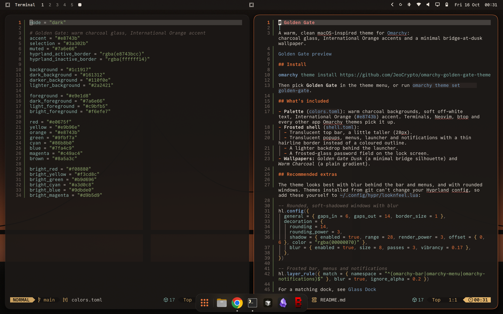

# Golden Gate

A warm, clean macOS-inspired theme for [Omarchy](https://omarchy.org): charcoal glass, International Orange accents and a minimal bridge-at-dusk wallpaper.



## Install

```bash
omarchy theme install https://github.com/JeoCrypto/omarchy-golden-gate-theme
```

Then pick **Golden Gate** in the theme menu, or run `omarchy theme set golden-gate`.

## What's included

- **Palette** (`colors.toml`): warm charcoal backgrounds, soft off-white text, International Orange (`#e8743b`) accent. Terminals, Neovim, btop and every other app Omarchy themes pick it up.
- **Frosted shell** (`shell.toml`):
  - Translucent top bar, a little taller (28px).
  - Translucent popups, menus, launcher and notifications with a thin hairline border instead of a coloured outline.
  - A lighter backdrop behind the launcher.
  - A frosted-glass password field on the lock screen.
- **Wallpapers:** *Golden Gate Dusk* (a minimal bridge silhouette) and *Warm Charcoal* (a plain gradient).

## Recommended extras

The theme looks best with blur behind the bar and menus, and with rounded windows. Themes installed from git can't change your Hyprland config, so add these yourself to `~/.config/hypr/looknfeel.lua`:

```lua
-- Rounded, soft-shadowed windows with blur
hl.config({
  general = { gaps_in = 6, gaps_out = 14, border_size = 1 },
  decoration = {
    rounding = 14,
    rounding_power = 3,
    shadow = { enabled = true, range = 28, render_power = 3, offset = { 0, 6 }, color = "rgba(00000070)" },
    blur = { enabled = true, size = 8, passes = 3, vibrancy = 0.17 },
  },
})

-- Frosted bar, menus and notifications
hl.layer_rule({ match = { namespace = "^(omarchy-bar|omarchy-menu|omarchy-notifications)$" }, blur = true, ignore_alpha = 0.2 })
```

For a matching dock, see [Glass Dock](https://github.com/JeoCrypto/omarchy-glass-dock).

Fonts used in the preview (all free): [Commit Mono](https://commitmono.com) for terminals and the bar (`otf-commit-mono-nerd`, then `omarchy font set "CommitMono Nerd Font"`), [Atkinson Hyperlegible Next](https://www.brailleinstitute.org/freefont) for menus and apps, and [Literata](https://github.com/googlefonts/literata) for reading.

## License

MIT. The wallpapers were made for this theme and are covered by the same license.
