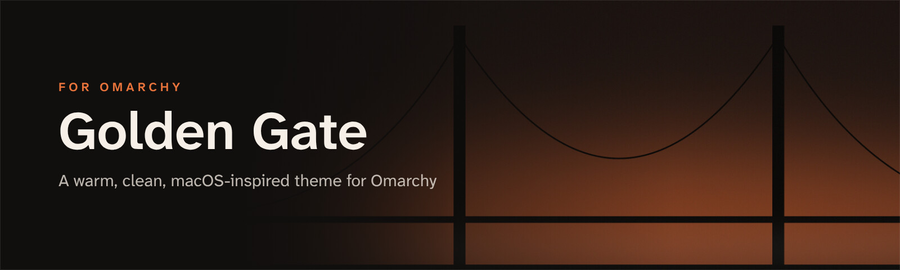
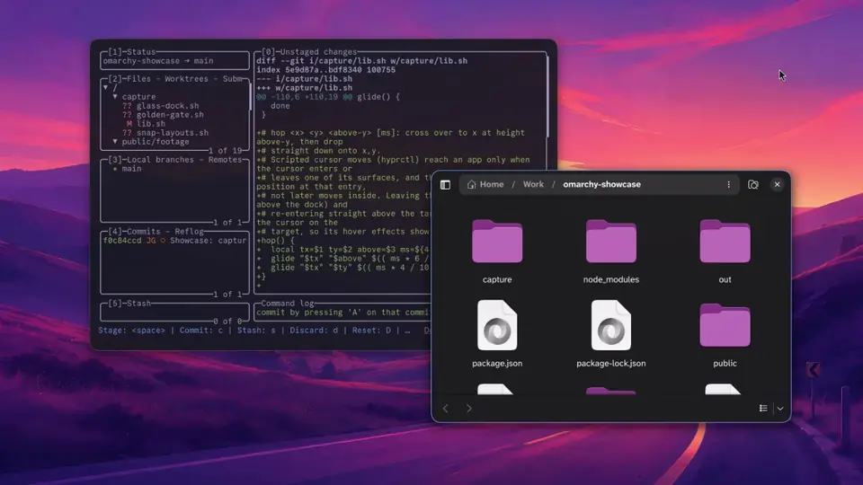

<p align="center">
  
</p>

<p align="center">
  <b>A warm, clean, macOS-inspired theme for <a href="https://omarchy.org">Omarchy</a>.</b><br>
  Charcoal glass · International Orange accents · frosted bar and menus · a bridge-at-dusk wallpaper
</p>

<p align="center">
  
  
  
</p>

<p align="center">
  
</p>

## Get started

```bash
omarchy theme install https://github.com/JeoCrypto/omarchy-golden-gate-theme
```

Then pick **Golden Gate** in the theme menu, or run `omarchy theme set golden-gate`.

## What's inside

<table>
  <tr>
    <td width="50%" valign="top">
      <h3>🎨 A warm palette</h3>
      Warm charcoal backgrounds, soft off-white text and an International Orange (<code>#e8743b</code>) accent. Terminals, Neovim, btop and every other app Omarchy themes pick it up.
    </td>
    <td width="50%" valign="top">
      <h3>🧊 A frosted shell</h3>
      A translucent top bar, a little taller (28px). Translucent popups, menus, launcher and notifications with a thin hairline border instead of a coloured outline, and a lighter backdrop behind the launcher.
    </td>
  </tr>
  <tr>
    <td valign="top">
      <h3>🔒 A glass lock screen</h3>
      A frosted-glass password field over your blurred wallpaper.
    </td>
    <td valign="top">
      <h3>🌉 Two wallpapers</h3>
      <i>Golden Gate Dusk</i>, a minimal bridge silhouette, and <i>Warm Charcoal</i>, a plain gradient. Both were made for this theme.
    </td>
  </tr>
</table>

## Recommended extras

The theme looks best with blur behind the bar and menus, and with rounded windows. Themes installed from git can't change your Hyprland config, so add these yourself to `~/.config/hypr/looknfeel.lua`:

```lua
-- Rounded, soft-shadowed windows with blur
hl.config({
  general = { gaps_in = 6, gaps_out = 14, border_size = 1 },
  decoration = {
    rounding = 14,
    rounding_power = 3,
    shadow = { enabled = true, range = 28, render_power = 3, offset = { 0, 6 }, color = "rgba(00000070)" },
    blur = { enabled = true, size = 8, passes = 3, vibrancy = 0.17 },
  },
})

-- Frosted bar, menus and notifications
hl.layer_rule({ match = { namespace = "^(omarchy-bar|omarchy-menu|omarchy-notifications)$" }, blur = true, ignore_alpha = 0.2 })
```

**Fonts used in the demo** (all free):

- [Commit Mono](https://commitmono.com) for terminals and the bar: install `otf-commit-mono-nerd`, then run `omarchy font set "CommitMono Nerd Font"`
- [Atkinson Hyperlegible Next](https://www.brailleinstitute.org/freefont) for menus and apps
- [Literata](https://github.com/googlefonts/literata) for reading

---

<p align="center">
  <b>Part of the Golden Gate set for Omarchy</b><br>
  <a href="https://github.com/JeoCrypto/omarchy-golden-gate-theme">Golden Gate theme</a> ·
  <a href="https://github.com/JeoCrypto/omarchy-glass-dock">Glass Dock</a> ·
  <a href="https://github.com/JeoCrypto/omarchy-spotlight-apps">Spotlight Apps</a> ·
  <a href="https://github.com/JeoCrypto/omarchy-snap-layouts">Snap Layouts</a>
</p>

<p align="center"><sub>MIT licence. The wallpapers were made for this theme and are covered by the same licence.</sub></p>
